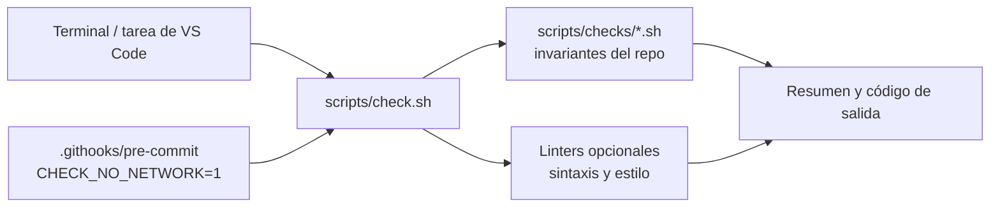

# Arquitectura

El repositorio tiene tres piezas: documentación por capas (cada archivo responde una sola pregunta, ver [README.md](README.md)), una autoevaluación determinista con un único punto de entrada y una configuración local que apunta a las bases teóricas externas.

## Estructura de carpetas

```yaml
# Estructura de carpetas desde la raíz: el valor de cada nombre es su
# descripción o, en los directorios, el mapa de su contenido.
AGENTS.md: "Contrato para agentes (fuente única de reglas)"
ARCHITECTURE.md: "Este documento"
CLAUDE.md: "Adaptador: importa AGENTS.md"
CONTRIBUTING.md: "Procedimientos de cambio"
README.md: "Entrada al proyecto"
pyproject.toml: "Dependencias de Python en .venv/ (estándar del repo)"
Dockerfile: "Imagen de desarrollo y verificación (ADR-0007)"
.devcontainer/: "Contenedor de desarrollo para VS Code"
.editorconfig: "Formato común para editores"
.gitattributes: "Normalización a LF"
.gitignore: "Exclusiones (incluye la configuración local)"
.markdownlint-cli2.jsonc: "Configuración de markdownlint-cli2"
.yamllint.yaml: "Configuración de yamllint"
.githooks/:
  pre-commit: "Hook: autoevaluación sin red"
.github/:
  copilot-instructions.md: "Adaptador: apunta a AGENTS.md"
  instructions/: "Reglas por ruta para Copilot (*.instructions.md)"
  workflows/:
    check.yml: "Integración continua con la imagen de desarrollo"
.vscode/:
  tasks.json: "Tareas de VS Code"
  settings.json: "Exclusiones de búsqueda y observador"
config/:
  external-bases.example: "Plantilla de la configuración local (versionada)"
  toolchain.env: "Versiones conocidas buenas de la toolchain"
docs/:
  adr/: "ADR en formato MADR e índice README.md"
  memory/: "Memoria del repositorio: índice README.md y entries.md"
  setup.md: "Puesta en marcha desde cero por entorno"
scripts/:
  check.sh: "Punto de entrada único de la autoevaluación"
  setup.sh: "Puesta en marcha idempotente del entorno"
  new-id.sh: "Generador de identificadores TypeID"
  now.sh: "Fecha del reloj del sistema para updated_at y fechas del repo"
  sandbox-clean.sh: "Limpieza explícita, dry-run por defecto"
  checks/: "Un script por invariante del repositorio"
  lib/:
    common.sh: "Utilidades compartidas por los chequeos"
src/: "Código del proyecto (vacío en la plantilla)"
tests/: "Regresión del aislamiento; sin pruebas de aplicación"
sandbox/: "Trabajo efímero ignorado, salvo dos controles"
.venv/: "Entorno virtual de Python (local, ignorado por git)"
```

La autoevaluación es POSIX `sh`; las utilidades pueden usar Python dentro de `.venv/` ([ADR-0003](docs/adr/0003-scripting-languages.md), [ADR-0006](docs/adr/0006-entorno-wsl-ubuntu-bash.md)).

## Autoevaluación

`scripts/check.sh` ejecuta primero los chequeos propios y después los linters. Termina con código 0 solo si no hay fallos.



Cada comprobación tiene un solo responsable:

| Comprobación | Responsable | Qué valida |
| --- | --- | --- |
| Archivos obligatorios | `scripts/checks/required-files.sh` | Existencia y contenido de la lista de archivos obligatorios. La lista está en el script. |
| Cabeceras y secciones | `scripts/checks/headers.sh` | Esquema de frontmatter de [ADR-0002](docs/adr/0002-frontmatter-schema.md), unicidad de `id`, coherencia de `name` y `file_path`, y secciones obligatorias por archivo. |
| Numeración de ADRs | `scripts/checks/adr-numbering.sh` | Nombres `NNNN-titulo.md`, secuencia desde 0001 sin huecos ni duplicados, y presencia en el índice. |
| Enlaces internos | `scripts/checks/internal-links.sh` | Que los destinos relativos existan; rechaza rutas absolutas. |
| Memoria del repositorio | `scripts/checks/memory.sh` | Presupuestos de [ADR-0004](docs/adr/0004-repository-memory.md), esquema y orden de los campos, ids únicos, coherencia entre índice y entradas, evidencia como ruta o commit, sin rutas absolutas ni tokens, y avisos de consolidación y caducidad. |
| Configuración externa | `scripts/checks/external-config.sh` | Que el archivo local esté ignorado y sin versionar, y que la ruta configurada exista, sea legible y esté fuera del repo. |
| Aislamiento efímero | `scripts/checks/sandbox.sh` | Índice y referencias operativas (incluidas las preparadas), reglas efectivas de Git, evidencia durable y avisos de antigüedad y tamaño. |
| Versiones de la toolchain | `scripts/checks/toolchain.sh` | Que las herramientas instaladas coinciden con `config/toolchain.env`; solo emite avisos. |
| Shell | shellcheck | Archivos `.sh` y hooks seleccionados, en modo `sh`. |
| Markdown | markdownlint-cli2 | Estilo y anclas `#` dentro del mismo archivo. |
| YAML | yamllint | Sintaxis de los `.yaml` y del frontmatter de cada `.md`. |
| Enlaces externos | lychee | URLs `http`/`https`. Se omite con `CHECK_NO_NETWORK=1`. |

Comportamiento:

- Las herramientas de Python se resuelven primero en `.venv/`, de modo que el resultado no depende de la terminal activa ([ADR-0007](docs/adr/0007-pyproject-y-toolchain-fijada.md)).
- Si un linter no está instalado, se emite un `AVISO` con el comando de instalación y se omite. Con `CHECK_STRICT=1` cuenta como fallo.
- Sin bases externas configuradas solo hay un `AVISO`, para que un clon recién creado pase el chequeo.
- `list_files` excluye el área efímera por defecto; `sh scripts/check.sh RUTA ...` añade rutas explícitas para promoción, con las mismas reglas de los linters y de documentación.
- Límites conocidos: no se validan las anclas hacia otros archivos (`otro.md#seccion`). El aislamiento revisa tanto índice como copia de trabajo; los demás chequeos revisan la copia de trabajo. Por ello, las regresiones de `tests/sandbox.sh` deben ejecutarse explícitamente al modificar el aislamiento efímero, el hook o la selección de archivos (no forman parte de cada invocación ordinaria de `check.sh`). Si en el futuro el flujo adopta commits parciales frecuentes o colaboración remota con CI, se considerará validar el commit preparado o en pipeline; el hook local no es una barrera invulnerable.
- El análisis de dependencias es estático: detecta el nombre literal de la zona en archivos operativos, no rutas construidas dinámicamente. Las menciones Markdown son documentales, no autorizan dependencias de ejecución.
- La limpieza exige raíz de plantilla, rechaza enlaces y solo borra unidades inmediatas completas; sin escrituras concurrentes. Detalles y excepciones en [ADR-0005](docs/adr/0005-ephemeral-workspace.md).

## Bases teóricas externas

La ruta se resuelve en este orden:

1. Variable de entorno `EXTERNAL_BASES_DIR`.
2. Clave `EXTERNAL_BASES_DIR` en `config/external-bases.local`, que está ignorado por git. Se lee como datos y no se ejecuta.
3. Ninguna: queda sin configurar y se emite un aviso.

Las reglas de uso por parte de los agentes están en [AGENTS.md](AGENTS.md). Las decisiones que justifican esta estructura están en [docs/adr/](docs/adr/README.md).
